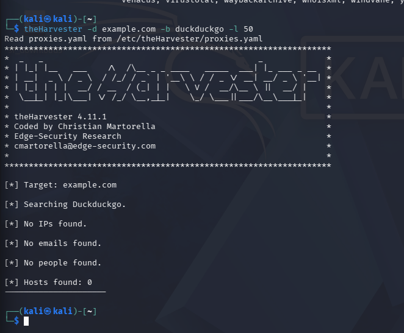
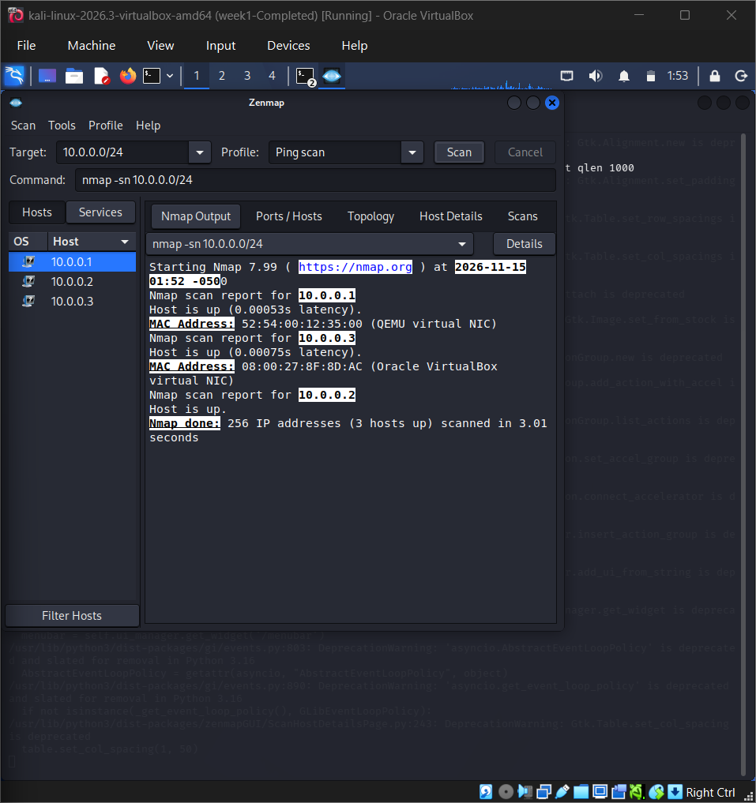
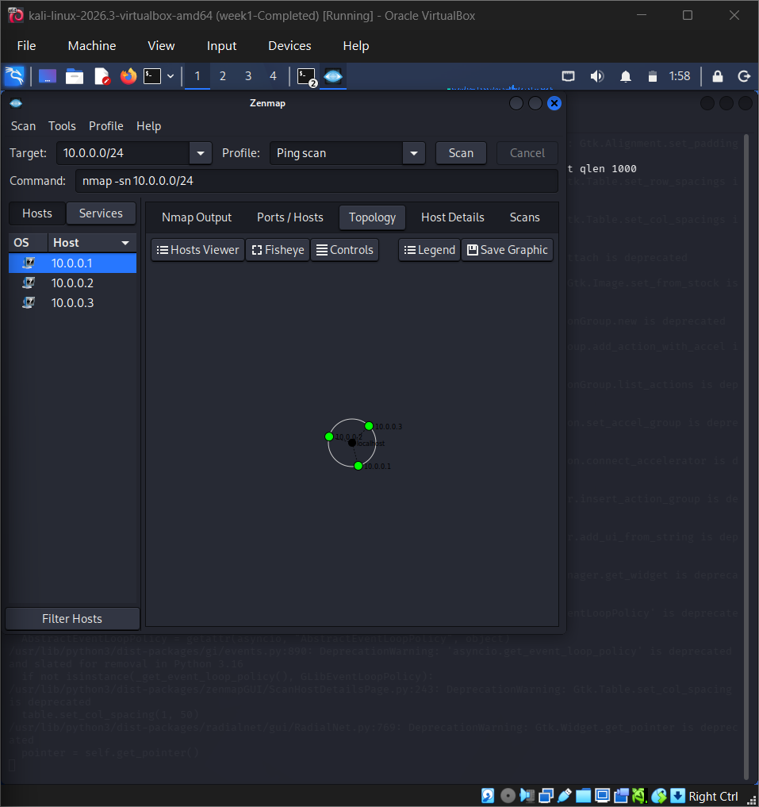

# NETWORKWALKS-WK2-PENETRATION-TESTING-REPORT

## Penetration Testing Practical Report

**Internship Program:** NETWORKWALKS Cybersecurity Internship  
**Project:** Week 2 - Footprinting and Network Scanning  
**Student:** Srimanya  
**Tools Used:** Kali Linux, TheHarvester, Zenmap, Nmap, Oracle VirtualBox  

---

## 1. Project Overview

This project documents the practical cybersecurity activities completed during Week 2 of the NETWORKWALKS Cybersecurity Internship.

The objective of these activities was to understand domain footprinting, Open-Source Intelligence (OSINT), network discovery, and network topology visualization using cybersecurity tools.

The practical work was divided into two main tasks:

- **W2-PM4:** Domain Footprinting using TheHarvester.
- **W2-PM5:** Network Scanning and Topology Mapping using Zenmap.

---

## 2. Tools and Technologies Used

| Tool | Purpose |
|---|---|
| Kali Linux | Cybersecurity testing environment |
| TheHarvester | Collecting publicly available domain information |
| Zenmap | Graphical interface for Nmap |
| Nmap | Network discovery and scanning |
| Oracle VirtualBox | Running the Kali Linux virtual machine |

---

## 3. W2-PM4: Domain Footprinting Using TheHarvester

### Objective

To understand how publicly available information about a domain can be collected using TheHarvester.

### Target Domain

`microsoft.com`

### Task 1: Footprinting Using Baidu

TheHarvester was used with Baidu as the information source to collect publicly available information related to the target domain.

**Activities performed:**
- Selected Baidu as the data source.
- Performed domain footprinting.
- Explored the collected host and subdomain information.
- Observed the results generated by the tool.

### Task 2: Footprinting Using All Available Sources

TheHarvester was also executed using multiple available data sources.

**Activities performed:**
- Selected all available sources.
- Set the required search limit to 50.
- Collected publicly available domain-related information.
- Observed discovered hostnames and subdomains.
- Reviewed warnings related to sources requiring API keys.

### Key Observations

- TheHarvester helps gather publicly available information about a target domain.
- It can identify hostnames and subdomains.
- Different data sources may return different results.
- Some sources require API keys for complete access.

### Screenshot Evidence

---

## 4. W2-PM5: Network Scanning Using Zenmap

### Objective

To identify active hosts within a local network and understand network topology visualization using Zenmap.

### Lab Environment

| Configuration | Details |
|---|---|
| Operating System | Kali Linux |
| Virtualization | Oracle VirtualBox |
| Network Type | NAT Network |
| Network Name | NW-Lab |
| Network Range | 10.0.0.0/24 |
| Kali Linux IP | 10.0.0.2 |

### Task 1: Network Discovery Using Ping Scan

A Ping Scan was performed using Zenmap to identify active devices within the local lab network.

**Target Network:**

`10.0.0.0/24`

**Scan Type:** Ping Scan

### Results

The scan identified the following active hosts:

| IP Address | Observation |
|---|---|
|          | Gateway |
|          | Kali Linux VM |
|          | Another detected network host |

**Total Active Hosts Detected: 3**

### Screenshot Evidence

### Task 2: Network Topology Visualization

The network topology feature in Zenmap was explored to understand how discovered hosts are represented visually.

The topology view helped visualize the detected hosts in the local lab network.

### Screenshot Evidence

---

## 5. Key Learning Outcomes

Through these practical activities, I gained an understanding of:

- Open-Source Intelligence (OSINT).
- Domain footprinting and reconnaissance.
- Subdomain and hostname discovery.
- Using TheHarvester with different data sources.
- Network discovery using Nmap and Zenmap.
- Identifying active hosts in a local network.
- Understanding network topology visualization.
- Working with Kali Linux in a virtual lab environment.

---
## 6. Authorization, Scope and Disclaimer

### Educational Purpose

This project was completed as part of the NETWORKWALKS Cybersecurity Internship for educational and research purposes.

### Scope of Activities

- TheHarvester was used to explore publicly available information associated with the specified domain as part of an OSINT learning exercise.
- Zenmap network discovery was performed within my own local virtual lab environment.
- No unauthorized access to systems or data was attempted.

### Activities Not Performed

The following activities were not performed:

- Exploitation of vulnerabilities.
- Unauthorized access or privilege escalation.
- Denial-of-Service (DoS) attacks.
- Brute-force or password attacks.
- Accessing private or confidential information.
- Social engineering.

### Disclaimer

This repository documents educational cybersecurity exercises only. The findings are shared for learning and documentation purposes. No affiliation with or endorsement by any third-party organization is implied.

All testing activities should be conducted only on systems owned by the tester or with explicit authorization from the relevant owner.
## 7. Conclusion

The Week 2 practical activities provided hands-on experience with domain footprinting and network scanning.

Using TheHarvester, I explored how publicly available domain information can be collected through different sources.

Using Zenmap, I performed a Ping Scan on my local virtual lab network and identified three active hosts. I also explored the network topology visualization feature.

These exercises helped strengthen my understanding of reconnaissance, OSINT, network discovery, and practical cybersecurity tools.

---

## 8. Project Files

The repository contains the following practical evidence and report:

- TheHarvester screenshot.
- Zenmap Ping Scan screenshot.
- Zenmap Network Topology screenshot.

---

**Created by:** Srimanya  
**Program:** NETWORKWALKS Cybersecurity Internship  

#NetworkWalks #CyberSecurity #EthicalHacking #KaliLinux #TheHarvester #Nmap #Zenmap
